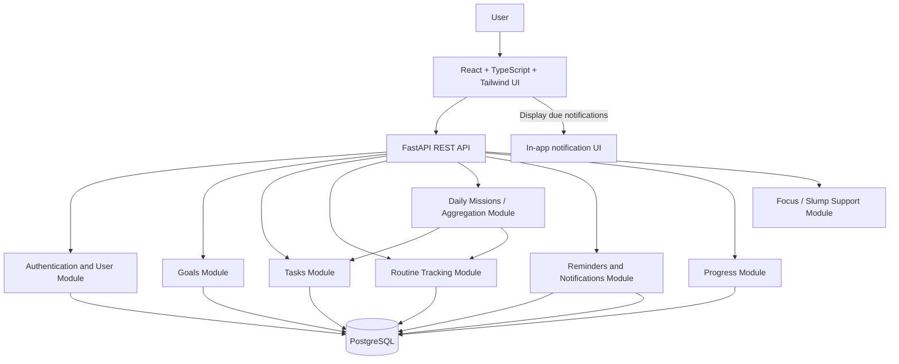

# Taskflow — Architecture and Technology Decisions

## 1. Locked technology stack
| Layer | Technology | Requirement |
|---|---|---|
| Frontend | React + TypeScript | Component-based responsive web UI |
| Styling | Tailwind CSS | Consistent, maintainable styling |
| Backend | FastAPI (Python) | REST-style JSON API and request validation |
| Database | PostgreSQL | Persistent relational storage |
| Architecture | Modular monolith | One deployable backend with separated modules |
| Lifecycle | Agile | Iterative/incremental implementation in short sprints |
| API docs | FastAPI OpenAPI/Swagger UI | Use generated API documentation |
| Testing | pytest + HTTP client; Apache JMeter | Functional/API tests plus controlled HTTP workload tests |

Do not replace the stack without documenting a genuine blocker and asking for approval. Reuse existing project configuration where it is sound.

## 2. Logical architecture


## 3. Module responsibilities
- **Authentication/User:** registration, login, logout, identity context, user ownership.
- **Goals:** user-owned goals, descriptions, optional target date, active/completed state, linked tasks.
- **Tasks:** task CRUD, status, priority, deadline/schedule, completion, optional goal link.
- **Routines:** recurring activity definitions and dated completion records.
- **Daily Missions:** read model for today's scheduled/due tasks and today's routine occurrences. It should aggregate source records rather than copy them into a second editable database unless a clear requirement justifies it.
- **Reminders/Notifications:** reminder settings, due-time checks, duplicate prevention, notification records/inbox. If a local scheduler is used, document that background delivery depends on the backend process being alive.
- **Progress:** calculations derived from completed tasks and routine logs; do not store inconsistent totals that can be calculated.
- **Focus/Slump Support:** deterministic prompt/next-action helper; no medical claims and no silent data mutation.

## 4. Suggested repository layout
Adapt to the existing repository rather than blindly replacing it.

```text
taskflow/
  frontend/
    src/
      app/
      components/
      features/
        auth/
        dashboard/
        goals/
        tasks/
        daily-missions/
        routines/
        reminders/
        progress/
        focus-support/
      lib/              # API client, auth/session helpers
      types/
  backend/
    app/
      main.py
      core/             # settings, security, database
      api/              # router registration
      models/
      schemas/
      services/
      routers/
      jobs/             # reminder scheduler if used
    tests/
    migrations/
    requirements.txt
  docs/
  tests/
  .env.example
  README.md
```

## 5. Backend structure
Use routers for route definitions, schemas for input/output validation, services for business rules, and database models/repositories for persistence. Keep route handlers thin. Use dependency injection for database sessions and authenticated user identity. Add migrations (Alembic recommended if compatible with current repository). Avoid putting all logic in `main.py`.

## 6. Security baseline
- Passwords hashed with a suitable password-hashing library; never plaintext.
- Auth token/session handling appropriate for a local prototype; document the selected strategy.
- Every user-owned query must be scoped to the authenticated user.
- Validate task ownership before update/delete/complete.
- Store secrets in environment variables; commit only `.env.example`.
- Use parameterized ORM/database operations.
- In production deployment use HTTPS; for local development document localhost HTTP.
- Avoid returning password hashes, tokens in logs, raw SQL, or stack traces.

## 7. Deployment/runtime
Local development should have clear commands for PostgreSQL, FastAPI, and frontend. Include health endpoint only if implemented; a recommended `/health` route returns a simple status and does not expose secrets. Use environment-based configuration. Include a demo seed command only if it is safe and documented.
