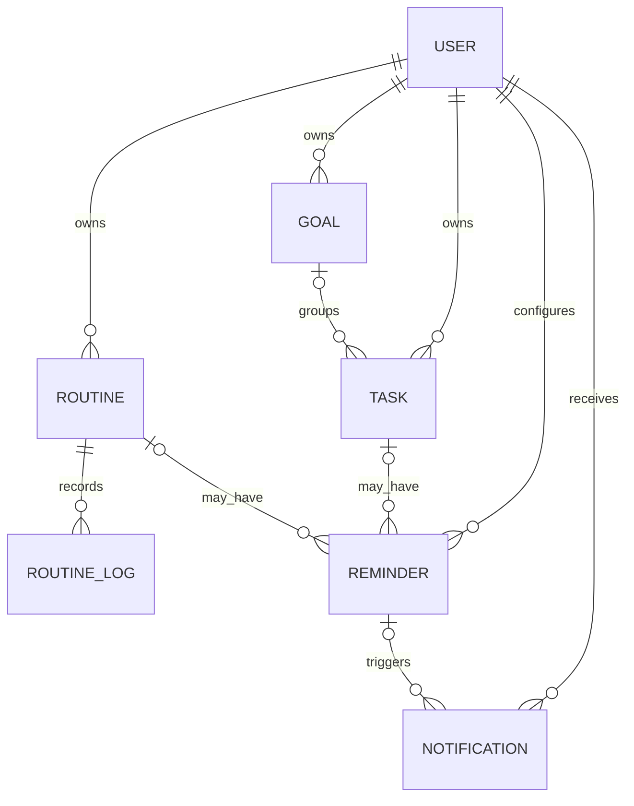

# Taskflow — Logical Data Model

The original Software Design Document defines `USER`, `TASK`, `ROUTINE`, `ROUTINE_LOG`, and `REMINDER`. The locked product flow also includes Goals, Daily Missions, Notifications, and Progress. This addendum extends the logical model while keeping the core relational design small.

## 1. Entities
### User
- `id` primary key
- `name`
- `email` unique, normalized
- `password_hash`
- `created_at`, `updated_at`

### Goal
- `id` primary key
- `user_id` foreign key → User
- `title` required
- `description` nullable
- `target_date` nullable
- `status` (`active`, `completed`, `archived`)
- timestamps

### Task
- `id` primary key
- `user_id` foreign key → User
- `goal_id` nullable foreign key → Goal
- `title` required
- `description` nullable
- `priority` (`low`, `medium`, `high`)
- `status` (`pending`, `completed`)
- `deadline` nullable
- `scheduled_start`, `scheduled_end` nullable
- `created_at`, `updated_at`, `completed_at` nullable

### Routine
- `id` primary key
- `user_id` foreign key → User
- `name` required
- `description` nullable
- `schedule` / recurrence representation
- `active` boolean
- timestamps

### RoutineLog
- `id` primary key
- `routine_id` foreign key → Routine
- `occurrence_date`
- `completed` boolean
- `completed_at` nullable
- unique constraint on (`routine_id`, `occurrence_date`)

### Reminder
- `id` primary key
- `user_id` foreign key → User
- exactly one of `task_id` or `routine_id` must be set
- `due_at`
- `enabled`
- `notification_sent_at` nullable
- `created_at`, `updated_at`
- enforce ownership through service validation and/or suitable database constraints

### Notification
- `id` primary key
- `user_id` foreign key → User
- `reminder_id` nullable foreign key → Reminder
- `title`, `body`
- `created_at`
- `read_at` nullable
- uniqueness/idempotency rule to prevent duplicate notification records for the same reminder firing

## 2. Daily Missions and Progress
Daily Missions should be computed from:
- tasks scheduled for or due on the selected date (document the chosen rule);
- routine definitions active on that date and their completion logs.

Progress should be computed from completed tasks and routine logs in a date range. Do not create denormalized counters unless there is a demonstrated need and tests ensure consistency.

## 3. Relationships

## 4. Integrity and deletion rules
- All user-owned data belongs to one valid user.
- A task's `goal_id`, if present, must refer to a goal owned by the same user.
- Never allow a user to read/update/delete another user's goal, task, routine, reminder, or notification.
- Task title and routine name cannot be blank.
- When deleting a task or routine, delete/deactivate its reminders and handle notification history consistently.
- Deleting a goal should either set linked tasks' `goal_id` to null or block deletion until reassigned; choose one behavior and test/document it.
- Use database constraints for uniqueness and foreign keys where practical.
- Use migrations or a reproducible schema creation process.

## 5. Persistence acceptance check
Create a task, goal, routine, and reminder; restart backend/frontend; verify records remain. Use a real PostgreSQL instance for the agreed stack. If local development temporarily uses another database for an existing test harness, clearly label that as a deviation and do not present it as the final architecture.
