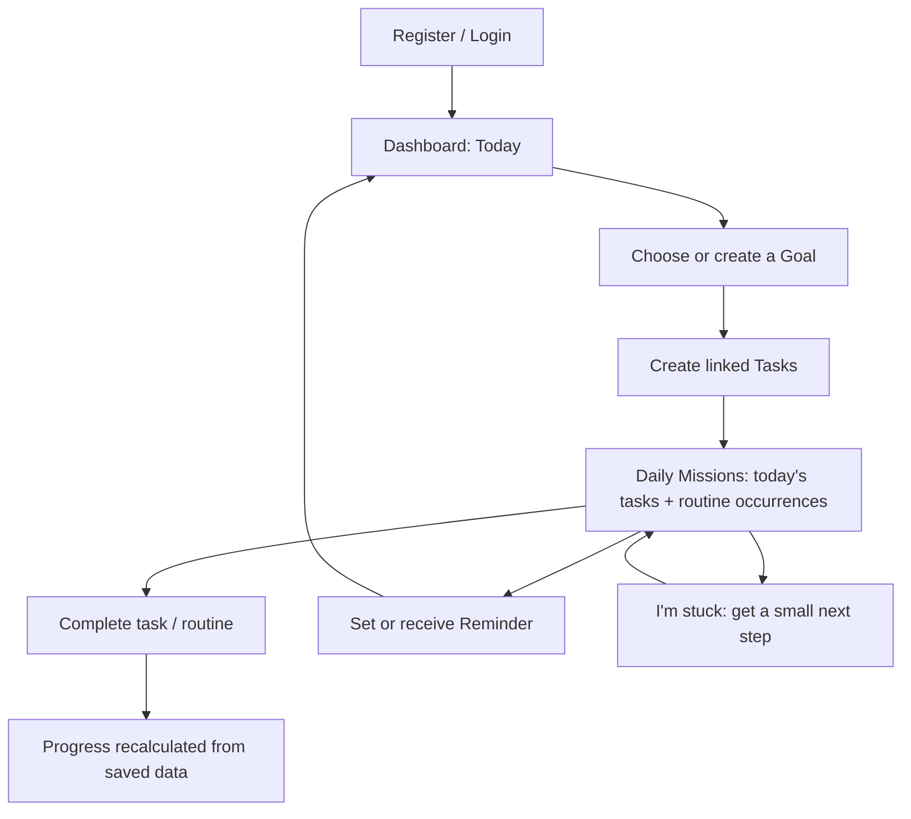

# Taskflow — UI/UX and User Flow Brief

## 1. Experience principles
- Low-distraction, calm, focused, and fast to navigate.
- The app is a **daily reminder and consistency tool**, not a generic project manager.
- Prioritize “What should I do today?” over complex reporting or project administration.
- Clear distinction between pending and completed items.
- Common actions (add task, mark complete, view today's missions) should be immediately accessible.
- Use accessible contrast, labels, keyboard focus, readable type, responsive layouts, and clear validation.

## 2. Main navigation
Recommended navigation:
1. Dashboard / Today
2. Goals
3. Tasks
4. Routines
5. Reminders / Notifications
6. Progress
7. Focus support entry point (contextual button, not necessarily a permanent navigation item)
8. Profile / Log out

Use a sidebar on desktop and compact navigation on mobile if appropriate. Do not overpopulate the UI.

## 3. Required screens
### Register / Login
- Email and password; name at registration if required.
- Inline validation and safe error messages.
- Clear login/register switch.
- Do not display secret values or password hashes.

### Dashboard / Today
- Greeting and date.
- Today's Daily Missions: tasks due/scheduled today and today's routine occurrences.
- Quick-add task.
- Small summary: pending today, completed today, routine completion.
- Upcoming deadlines and due reminders.
- A focus-support action for when the user feels stuck.
- Empty state with an actionable prompt when no missions exist.

### Goals
- List goals with title, optional target date, status, and task completion progress derived from linked tasks.
- Create/edit/archive or complete a goal.
- Open a goal to see its associated tasks.
- Do not show fake progress; derive it from real records.

### Tasks
- List tasks with status, priority, deadline/scheduled time, and optional goal.
- Create/edit/delete/complete.
- Validate required title, dates, and ownership.
- Filter/sort only as time allows after CRUD works.

### Routines
- Create recurring routine with name and selected weekdays or a documented recurrence rule.
- See today's completion state.
- Mark today's occurrence complete/incomplete.
- Historical completion records should not be overwritten when the next day starts.

### Reminders / Notifications
- Set reminder time and enable/disable.
- Show due reminders and in-app notifications.
- Mark notification read.
- Explain browser notification permission if implemented. Do not promise delivery while browser/backend is unavailable unless infrastructure truly supports it.

### Progress
- Show real counts/percentages for completed tasks and routines in a selected period.
- Keep charts simple and labeled. If no data exists, show an honest empty state.

### Focus / Slump support
- User selects “I’m stuck” or similar.
- Offer one short, practical next action (e.g., “Work on this for five minutes” or “Break it into the smallest next step”).
- Provide a return-to-task action.
- Never shame the user or make mental-health diagnoses.
- Do not automatically change task status or delete/reorder tasks.

## 4. Primary flow

## 5. Visual design constraints
The agent may choose the exact palette and typography, but must keep the visual system consistent and restrained. Use Tailwind tokens/components rather than scattered one-off styles. Avoid excessive animations, distracting gradients, unnecessary gamification, and crowded dashboards. Favor strong hierarchy, whitespace, clear task states, and obvious primary actions.

## 6. UX quality checks
- Keyboard and focus states are visible.
- Form errors appear next to the relevant field or action.
- Destructive delete actions require confirmation or provide a safe undo strategy.
- Loading and empty states are present.
- Layout works at desktop and mobile widths.
- Every visible button performs its stated action; no decorative/inert controls.
