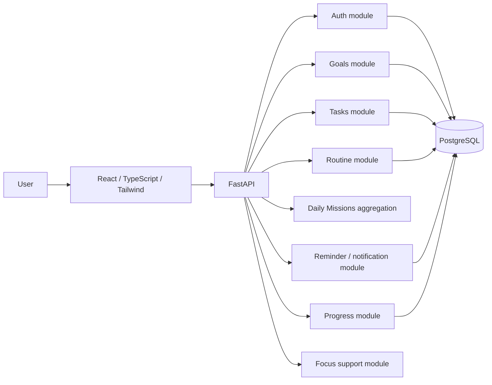
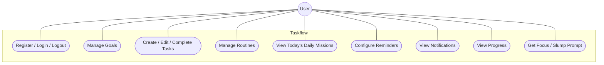
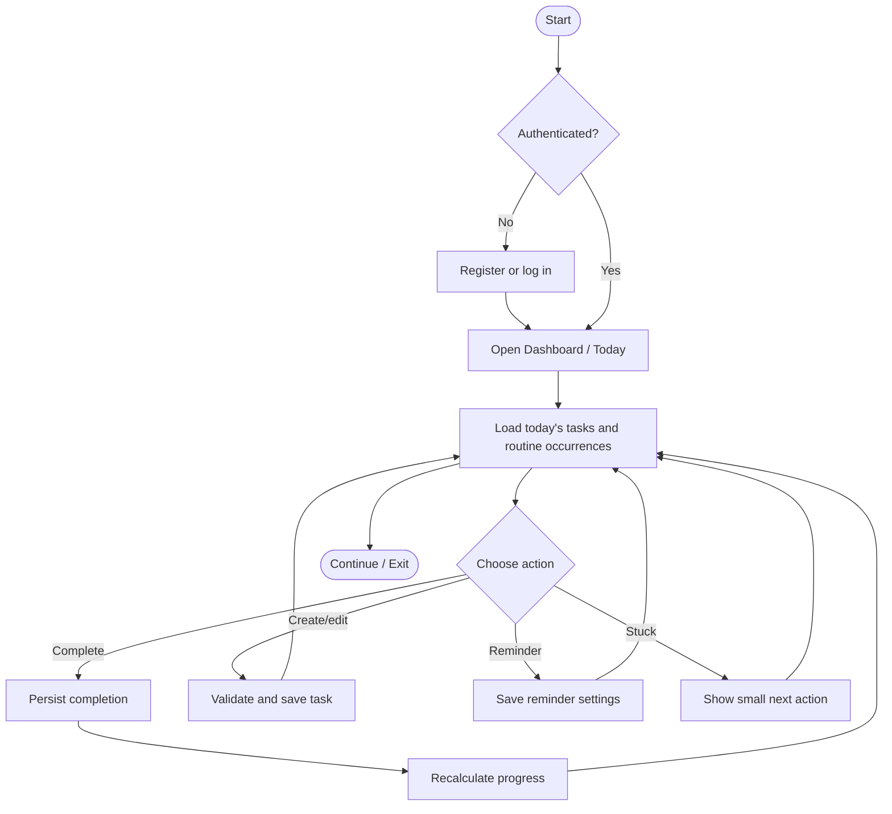

# Taskflow — System and User Flow Diagrams

## System architecture

## Use-case diagram

## Daily workflow activity diagram

## Data model
See `02_IMPLEMENTATION_SPEC/04_DATA_MODEL.md` for entity details and ownership/integrity rules.
